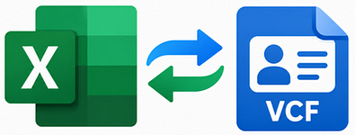

# Excel-VCF-Converter

Excel-VCF-Converter is a macro-enabled Microsoft Excel workbook for moving contact data between a worksheet and vCard (`.vcf`) files. It exports contacts as vCard 3.0 and imports contact records from VCF files into the workbook.

## Features

- Import VCF contacts into the Data sheet, appending them after existing rows.
- Preview the detected encoding and contact names, and confirm before importing.
- Add worksheet columns for recognized or custom VCF fields that are not already present, when enabled in Settings.
- Export all rows or selected rows; rows hidden by an active filter are excluded.
- Configure name formatting, phone-number normalization, import encoding, line folding, and other import/export options.
- Remove duplicate rows by matching all columns or name columns, and clear contact data with confirmation.
- Optionally write import/export warnings and skipped values to a Log sheet.
- Choose the workbook interface language from Settings.

## Requirements

- Desktop Microsoft Excel with VBA macros enabled.
- The `.xlsm` workbook. The `.bas` files in `src/` are source-code files and are not a standalone application.

## Getting Started

1. Download `Excel-VCF-Converter.xlsm` from this repository and open it in desktop Excel.
2. Enable macros if Excel displays a security warning. Only enable macros for a copy you trust.
3. Use the buttons on the Data sheet to import or export contacts, remove duplicates, clear data, or open Settings.

### Import VCF

1. Select **Import** and choose a `.vcf` file.
2. Review the encoding, contact preview, and any warnings or new columns in the confirmation dialog.
3. Confirm to append the contacts below the existing data. Select **No** to cancel without writing.

The import process supports common contact properties, quoted-printable text, folded lines, and automatic encoding detection. Depending on the Settings options, it can create columns for missing fields and normalize phone numbers. Binary fields such as photos, logos, sounds, and keys are not imported.

### Export VCF

1. Keep contact data under the headers on the Data sheet.
2. Select **Export** and choose where to save the `.vcf` file.
3. If prompted, confirm replacing an existing file.

The exporter creates vCard 3.0 entries. Rows without a name or organization are skipped. The export scope can be set to all rows or selected rows in Settings; active filters also exclude hidden rows.

## Settings

Open **Settings** from the Data sheet to configure the workbook. Options include language, import encoding and ANSI code page, whether to add missing fields, phone formatting and country/trunk prefixes, the display-name order, export scope, vCard line folding, output BOM, duplicate matching, highlighting imported rows, and operation logging.

## Repository Contents

- `Excel-VCF-Converter.xlsm`: the macro-enabled workbook.
- `src/mExport.bas`: VCF export logic.
- `src/mImport.bas`: VCF parsing and import logic.
- `src/mFields.bas`: field definitions and worksheet-column management.
- `src/mCodec.bas`: text, encoding, vCard, date, and phone-format helpers.
- `src/mSettings.bas`: settings, language, and workbook references.
- `src/mTools.bas`: progress, logging, duplicate removal, and data clearing.

The VBA modules are provided as readable source files for review and development. Changes to a `.bas` file do not automatically update the macros embedded in the `.xlsm` workbook; import the updated module into the workbook's VBA project and save the workbook to synchronize them.

## Privacy

Before sharing the workbook, remove personal contact information from the Data sheet and, if present, the Log sheet.

## 📄 License

This project is licensed under the GPL-3.0 License - see the [LICENSE](LICENSE) file for details.

## Author

Mesut Akcan  
[Blog](https://mesutakcan.blogspot.com) · [YouTube](https://www.youtube.com/mesutakcan)

For bug reports or suggestions, open an issue in this repository.
