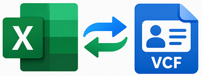

[Türkçe](README.tr.md) | [English](README.md)

# Excel-VCF-Converter

Excel-VCF-Converter is a macro-enabled Microsoft Excel workbook for managing contacts in a worksheet and exchanging them as vCard (`.vcf`) files. It imports VCF contacts into the **Data** sheet and exports contacts as vCard 3.0.

## What's New in v3.0

- Added **Find Similar Contacts**, a read-only analysis that groups likely duplicate contacts by shared phone numbers or email addresses and compatible names.
- Added four configurable similarity levels—**Exact**, **Safe**, **Normal**, and **Extended**—so strict matches can be handled automatically while ambiguous matches remain available for review.
- Added **Apply Merge** to combine confirmed automatic groups using a choice of keeping the main record, filling empty fields, or combining compatible values from every record.
- Added a **Merge** report for the proposed actions and a **MergeBackup** sheet that preserves every row removed by a merge, together with its merge context.
- Extended operation logging and Clear Data so merge analysis, backups, and logs are included in the workbook's contact-management workflow.

## Features

- Import VCF contacts into the Data sheet after the existing records.
- Preview detected encoding, contact names, skipped fields, phone-format changes, and planned new columns before an import writes anything.
- Read common vCard properties, folded lines, quoted-printable values, UTF-8, and ANSI-encoded files.
- Add or restore Data columns for recognised and custom VCF fields during import when enabled in Settings.
- Export all data rows or only selected rows as vCard 3.0. Filter-hidden rows are not exported.
- Write properly escaped vCard text, optionally fold lines at the vCard limit, and choose whether exported UTF-8 files include a BOM.
- Optionally normalize unambiguous phone numbers during import, export, or both.
- Remove exact duplicate worksheet rows, or duplicate rows based on name columns.
- Find likely duplicate contacts before changing data, then merge confirmed automatic groups while leaving uncertain groups for review.
- Back up rows removed by a contact merge to **MergeBackup** and optionally log import, export, and merge details to **Log**.
- Use the workbook interface in its configured language.

## Requirements

- Desktop Microsoft Excel with VBA macros enabled.
- The macro-enabled workbook, currently distributed here as `Excel-VCF-Converter.xlsm`.

The `.bas` files in `src/` are readable VBA source modules, not a standalone application.

## Getting started

1. Open `Excel-VCF-Converter.xlsm` in desktop Excel.
2. Enable macros only if you trust the workbook.
3. Use the buttons on the **Data** sheet to import, export, find similar contacts, apply a merge, remove duplicates, clear data, or open **Settings**.

Contact data starts below the header row on the Data sheet. Field columns are defined by the **Fields** sheet, so recognised contact columns can be moved or restored without tying the code to fixed column numbers.

## Import a VCF file

1. Select **Import** and choose a `.vcf` file.
2. Review the encoding, contact preview, warnings, phone formatting results, and any columns that will be added or restored.
3. Confirm to append the contacts; choose **No** to cancel without changing the Data sheet.

The importer supports common contact fields, quoted-printable text, folded lines, and automatic UTF-8/ANSI detection. Photos, logos, sounds, keys, and other binary fields are not imported. If a value has no available matching column, the importer either creates a suitable column (when enabled) or reports that field as skipped.

## Export a VCF file

1. Keep contacts under the headers on the **Data** sheet.
2. Select **Export** and choose the destination file.
3. Confirm if Excel asks to replace an existing file.

The exporter creates vCard 3.0 entries. Rows without both a name and an organization are skipped. Export scope can be set to all rows or selected rows; active filters always exclude hidden rows.

## Find and merge similar contacts

**Find Similar Contacts** analyses the Data sheet without modifying it and writes its results to the **Merge** sheet. Clear any active Data-sheet filter first.

Contacts are primarily linked through shared phone numbers or email addresses and compatible names. Exact duplicate rows are also detected. The chosen similarity level controls name matching:

- **Exact** — identical names with a shared phone number or email address.
- **Safe** — identical or containing names with a shared phone number or email address.
- **Normal** — Safe matching plus initials and one-character name variations.
- **Extended** — Normal matching plus order-independent name keys and wider, guarded links.

Common service numbers are handled conservatively. Ambiguous matches are marked for review instead of being merged automatically.

**Apply Merge** recalculates the plan, asks for confirmation, merges only automatic groups, and removes exact duplicate rows. Review groups remain unchanged. Before deleting rows, the workbook writes their original values and merge context to **MergeBackup**. The merge method is chosen in Settings:

- **Keep main only**
- **Fill empty fields**
- **Combine all** — uses available compatible fields and may add columns when allowed

## Settings

Open **Settings** from the Data sheet to configure:

- Interface language
- Import encoding and ANSI code page
- Whether missing/imported fields may create columns
- Phone handling: untyped-phone destination, formatting phase, country code, and national prefix
- Display-name format
- Export scope, UTF-8 BOM, and vCard line folding
- Highlighting imported rows and operation logging
- Duplicate-row matching rule
- Similar-contact matching level and merge method

Settings use localized display labels while the VBA code maps them back to stable internal values. If a setting is missing or blank, the workbook uses a defined default.

## Repository contents

- `Excel-VCF-Converter.xlsm` — macro-enabled Excel workbook.
- `src/mImport.bas` — VCF parsing, preview, field allocation, and import.
- `src/mExport.bas` — vCard 3.0 export.
- `src/mMerge.bas` — similar-contact analysis and Merge-sheet report.
- `src/mMergeApply.bas` — merge preparation, backup, field combination, and row removal.
- `src/mFields.bas` — field definitions and Data-sheet column management.
- `src/mSettings.bas` — settings, localization, and workbook references.
- `src/mCodec.bas` — vCard text, encoding, date, file, and phone helpers.
- `src/mTools.bas` — progress display, logging, duplicate removal, and data clearing.
- `docs/` — documentation assets.

## Developing the VBA source

Changes to files in `src/` do not automatically update the macros embedded in the `.xlsm` workbook. Import the changed VBA module into the workbook's VBA project and save the workbook to synchronize them. Keep a backup before replacing modules or editing contact data.

## Privacy

Before sharing the workbook, remove personal contact data from the **Data**, **MergeBackup**, and **Log** sheets if they exist.

## License

This project is licensed under the GPL-3.0 License. See [LICENSE](LICENSE) for details.

## Author

Mesut Akcan  
[Blog](https://mesutakcan.blogspot.com) · [YouTube](https://www.youtube.com/mesutakcan)

For bug reports or suggestions, open an issue in this repository.
