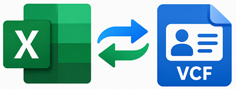

[Türkçe](README.tr.md) | [English](README.md)

# Excel-VCF-Converter

Excel-VCF-Converter, kişileri bir çalışma sayfasında yönetmek ve vCard (`.vcf`) dosyalarıyla alışveriş yapmak için tasarlanmış, makro etkin bir Microsoft Excel çalışma kitabıdır. VCF kişilerini **Data** sayfasına aktarır ve kişileri vCard 3.0 biçiminde dışa aktarır.

## v3.0'daki Yenilikler

- Ortak telefon numarası veya e-posta adresi ile uyumlu adlara göre muhtemel yinelenen kişileri gruplandıran, yalnızca analiz yapan **Benzer Kişileri Bul** özelliği eklendi.
- Kesin eşleşmelerin otomatik işlenmesini, belirsiz eşleşmelerin ise inceleme için ayrılmasını sağlayan dört yapılandırılabilir benzerlik düzeyi eklendi: **Tam**, **Güvenli**, **Normal** ve **Kapsamlı**.
- Doğrulanmış otomatik grupları; ana kaydı koruma, boş alanları doldurma veya tüm kayıtlardaki uyumlu değerleri birleştirme seçenekleriyle işleyen **Birleştirmeyi Uygula** özelliği eklendi.
- Önerilen işlemler için bir **Merge** raporu ve birleştirmede kaldırılan her satırı birleştirme bağlamıyla birlikte koruyan bir **MergeBackup** sayfası eklendi.
- Birleştirme analizi, yedekler ve günlükler; işlem günlüğü ve Verileri Temizle akışına dahil edildi.

## Özellikler

- VCF kişilerini mevcut kayıtların sonrasına, Data sayfasına aktarır.
- Aktarım veri yazmadan önce algılanan kodlamayı, kişi adlarını, atlanan alanları, telefon biçimi değişikliklerini ve eklenecek yeni sütunları önizletir.
- Yaygın vCard özelliklerini, katlanmış satırları, quoted-printable değerleri, UTF-8 ve ANSI kodlamalı dosyaları okur.
- Ayarlarda etkinleştirildiğinde, aktarım sırasında tanınan ve özel VCF alanları için Data sütunları ekler veya geri yükler.
- Tüm veri satırlarını ya da yalnızca seçili satırları vCard 3.0 biçiminde dışa aktarır. Filtre nedeniyle gizlenen satırlar dışa aktarılmaz.
- vCard metnini doğru biçimde kaçışlayarak yazar; satırları vCard sınırında katlamayı ve dışa aktarılan UTF-8 dosyalarına BOM eklenip eklenmeyeceğini seçmenizi sağlar.
- Açıkça tanınabilen telefon numaralarını aktarımda, dışa aktarımda veya her iki aşamada isteğe bağlı olarak normalleştirir.
- Tam olarak aynı çalışma sayfası satırlarını veya ad sütunlarına göre yinelenen satırları kaldırır.
- Verileri değiştirmeden önce muhtemel yinelenen kişileri bulur; ardından kesin otomatik grupları birleştirirken belirsiz grupları inceleme için bırakır.
- Kişi birleştirmesiyle kaldırılan satırları **MergeBackup** sayfasına yedekler; isteğe bağlı olarak aktarım, dışa aktarım ve birleştirme ayrıntılarını **Log** sayfasına yazar.
- Çalışma kitabı arayüzünü yapılandırılmış dilde kullanmanızı sağlar.

## Gereksinimler

- VBA makroları etkinleştirilmiş masaüstü Microsoft Excel.
- Şu anda `Excel-VCF-Converter.xlsm` olarak dağıtılan, makro etkin çalışma kitabı.

`src/` içindeki `.bas` dosyaları okunabilir VBA kaynak modülleridir; bağımsız bir uygulama değildir.

## Başlangıç

1. `Excel-VCF-Converter.xlsm` dosyasını masaüstü Excel'de açın.
2. Makroları yalnızca çalışma kitabına güveniyorsanız etkinleştirin.
3. **Data** sayfasındaki düğmelerle kişileri içe veya dışa aktarın, benzer kişileri bulun, birleştirmeyi uygulayın, yinelenenleri kaldırın, verileri temizleyin ya da **Settings** sayfasını açın.

Kişi verileri, Data sayfasında başlık satırının altında başlar. Alan sütunları **Fields** sayfasında tanımlanır; bu nedenle tanınan kişi sütunları kodu sabit sütun numaralarına bağlamadan taşınabilir veya geri yüklenebilir.

## VCF dosyasını içe aktarma

1. **Import** seçeneğini belirleyin ve bir `.vcf` dosyası seçin.
2. Kodlamayı, kişi önizlemesini, uyarıları, telefon biçimlendirme sonuçlarını ve eklenecek ya da geri yüklenecek sütunları inceleyin.
3. Kişileri eklemek için onaylayın; Data sayfasını değiştirmeden iptal etmek için **Hayır** seçeneğini belirleyin.

İçe aktarıcı; yaygın kişi alanlarını, quoted-printable metni, katlanmış satırları ve otomatik UTF-8/ANSI algılamayı destekler. Fotoğraflar, logolar, sesler, anahtarlar ve diğer ikili alanlar içe aktarılmaz. Bir değer için kullanılabilir eşleşen sütun yoksa aktarıcı, ilgili alanı ya uygun bir sütun oluşturarak (etkinleştirildiyse) işler ya da bu alanın atlandığını bildirir.

## VCF dosyasını dışa aktarma

1. Kişileri, **Data** sayfasındaki başlıkların altında tutun.
2. **Export** seçeneğini belirleyin ve hedef dosyayı seçin.
3. Excel mevcut dosyanın değiştirilmesini sorarsa onaylayın.

Dışa aktarıcı vCard 3.0 kayıtları oluşturur. Hem adı hem de kuruluşu olmayan satırlar atlanır. Dışa aktarma kapsamı tüm satırlar veya seçili satırlar olarak ayarlanabilir; etkin filtreler gizli satırları her zaman dışarıda bırakır.

## Benzer kişileri bulma ve birleştirme

**Benzer Kişileri Bul**, Data sayfasını değiştirmeden analiz eder ve sonuçları **Merge** sayfasına yazar. Önce Data sayfasındaki tüm etkin filtreleri temizleyin.

Kişiler öncelikle ortak telefon numaraları veya e-posta adresleri ve uyumlu adlar üzerinden ilişkilendirilir. Tam olarak aynı satırlar da algılanır. Seçilen benzerlik düzeyi ad eşleştirmesini belirler:

- **Tam** — Ortak telefon numarası veya e-posta adresiyle birlikte aynı adlar.
- **Güvenli** — Ortak telefon numarası veya e-posta adresiyle birlikte aynı ya da birbirini içeren adlar.
- **Normal** — Güvenli eşleştirmeye ek olarak baş harfler ve tek karakterlik ad farklılıkları.
- **Kapsamlı** — Normal eşleştirmeye ek olarak sözcük sırasından bağımsız ad anahtarları ve daha geniş, korumalı bağlantılar.

Yaygın hizmet numaraları temkinli işlenir. Belirsiz eşleşmeler otomatik olarak birleştirilmek yerine inceleme için işaretlenir.

**Birleştirmeyi Uygula**, planı yeniden hesaplar, onay ister, yalnızca otomatik grupları birleştirir ve tam yinelenen satırları kaldırır. İnceleme grupları değiştirilmez. Satırları silmeden önce çalışma kitabı, özgün değerleri ve birleştirme bağlamını **MergeBackup** sayfasına yazar. Birleştirme yöntemi Settings sayfasından seçilir:

- **Yalnızca ana kaydı koru**
- **Boş alanları doldur**
- **Tümünü birleştir** — mevcut uyumlu alanları kullanır ve izin verildiğinde sütun ekleyebilir

## Ayarlar

Şunları yapılandırmak için Data sayfasından **Settings** sayfasını açın:

- Arayüz dili
- Aktarım kodlaması ve ANSI kod sayfası
- Eksik/aktarılmış alanların sütun oluşturup oluşturamayacağı
- Telefon işleme: türü belirtilmemiş telefonun hedefi, biçimlendirme aşaması, ülke kodu ve ulusal önek
- Görünen ad biçimi
- Dışa aktarma kapsamı, UTF-8 BOM ve vCard satır katlama
- Aktarılan satırların vurgulanması ve işlem günlüğü
- Yinelenen satır eşleştirme kuralı
- Benzer kişi eşleştirme düzeyi ve birleştirme yöntemi

Ayarlar, yerelleştirilmiş görünen etiketleri kullanır; VBA kodu bunları kararlı iç değerlere eşler. Bir ayar yoksa veya boşsa, çalışma kitabı tanımlanmış varsayılan değeri kullanır.

## Depo içeriği

- `Excel-VCF-Converter.xlsm` — makro etkin Excel çalışma kitabı.
- `src/mImport.bas` — VCF ayrıştırma, önizleme, alan ayırma ve içe aktarma.
- `src/mExport.bas` — vCard 3.0 dışa aktarma.
- `src/mMerge.bas` — benzer kişi analizi ve Merge sayfası raporu.
- `src/mMergeApply.bas` — birleştirme hazırlığı, yedekleme, alanları birleştirme ve satır kaldırma.
- `src/mFields.bas` — alan tanımları ve Data sayfası sütun yönetimi.
- `src/mSettings.bas` — ayarlar, yerelleştirme ve çalışma kitabı başvuruları.
- `src/mCodec.bas` — vCard metni, kodlama, tarih, dosya ve telefon yardımcıları.
- `src/mTools.bas` — ilerleme göstergesi, günlük, yinelenenleri kaldırma ve veri temizleme.
- `docs/` — belge varlıkları.

## VBA kaynağını geliştirme

`src/` içindeki dosyalarda yapılan değişiklikler, `.xlsm` çalışma kitabına gömülü makroları otomatik olarak güncellemez. Değiştirilen VBA modülünü çalışma kitabının VBA projesine aktarın ve çalışma kitabını kaydederek eşitleyin. Modülleri değiştirmeden veya kişi verilerini düzenlemeden önce yedek alın.

## Gizlilik

Çalışma kitabını paylaşmadan önce varsa **Data**, **MergeBackup** ve **Log** sayfalarındaki kişisel kişi verilerini kaldırın.

## Lisans

Bu proje GPL-3.0 Lisansı ile lisanslanmıştır. Ayrıntılar için [LICENSE](LICENSE) dosyasına bakın.

## Yazar

Mesut Akcan  
[Blog](https://mesutakcan.blogspot.com) · [YouTube](https://www.youtube.com/mesutakcan)

Hata bildirimleri veya öneriler için bu depoda bir issue açın.
